# Life OS

Product showcase of a private app in development; source code is private.

  
  <a href="videos/tagebuch-ki.mp4">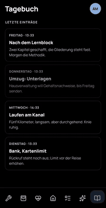</a>
  <a href="videos/review-finance.mp4">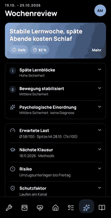</a>

  
  
  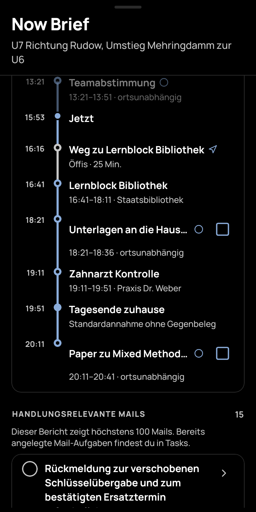

  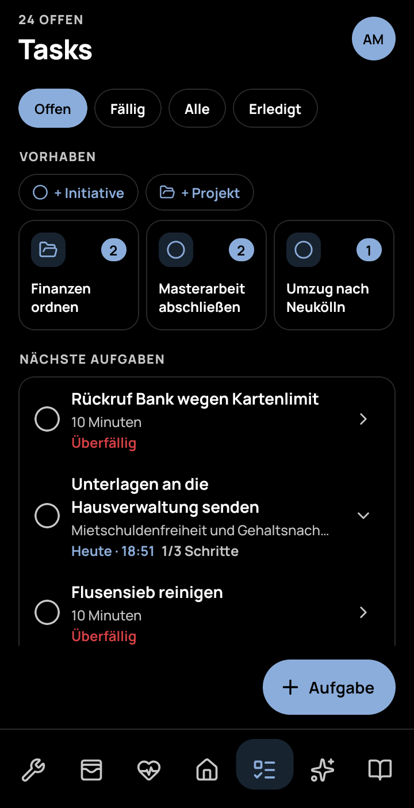
  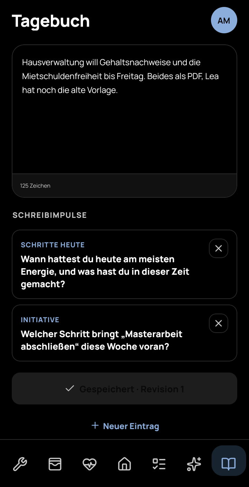
  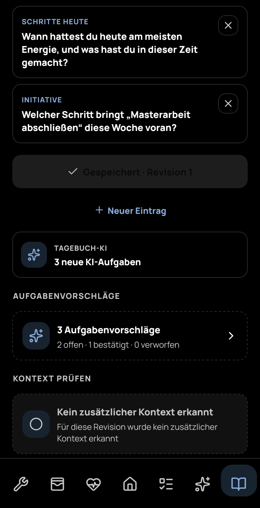

  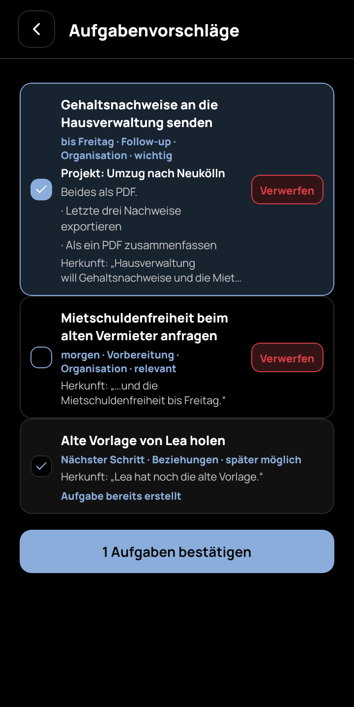
  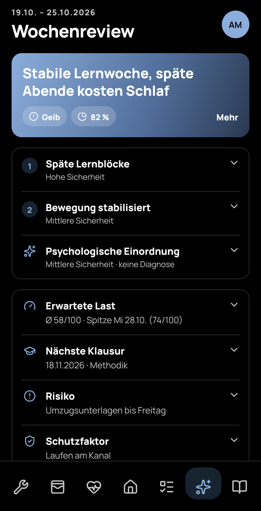
  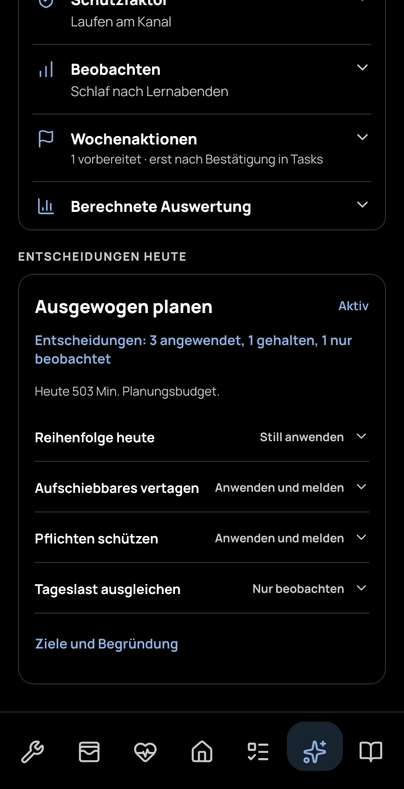

  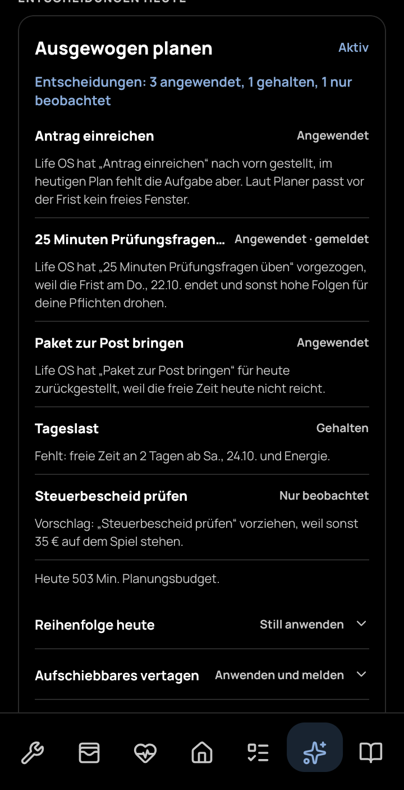
  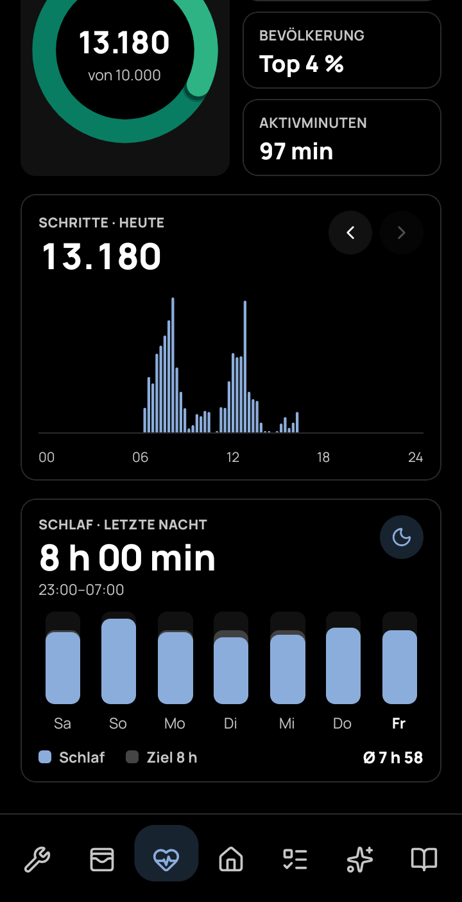
  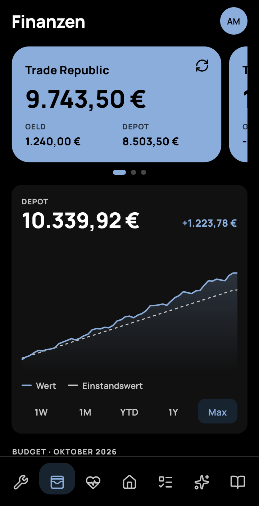

  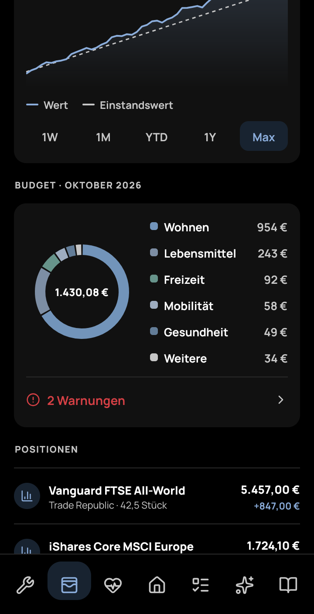
  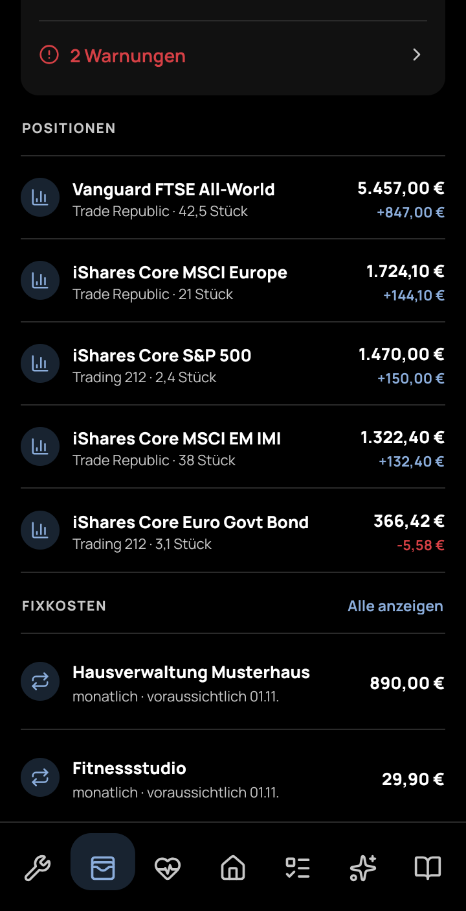
  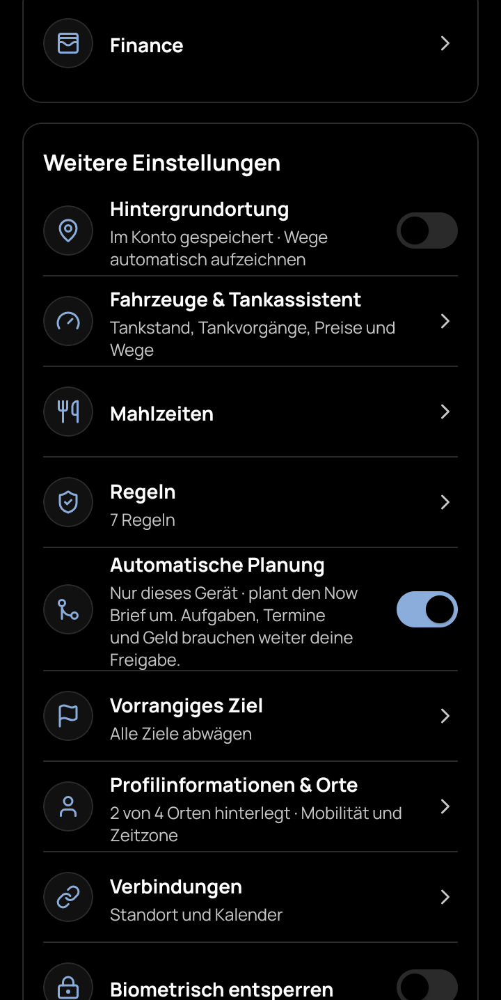

