# Life OS

Product showcase of a private app in development; source code is private.

  <a href="videos/now-brief.mp4">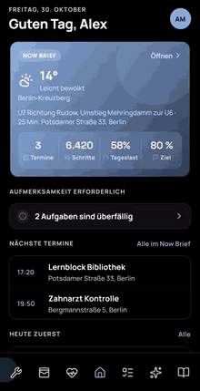</a>
  <a href="videos/tagebuch.mp4">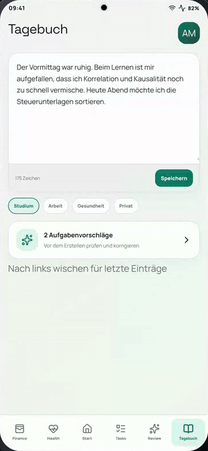</a>
  <a href="videos/wochenreview.mp4">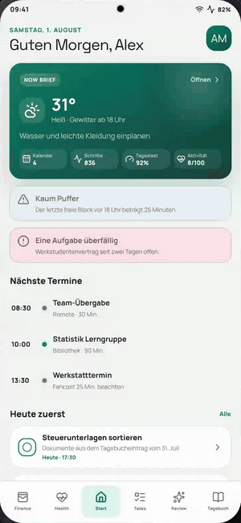</a>

  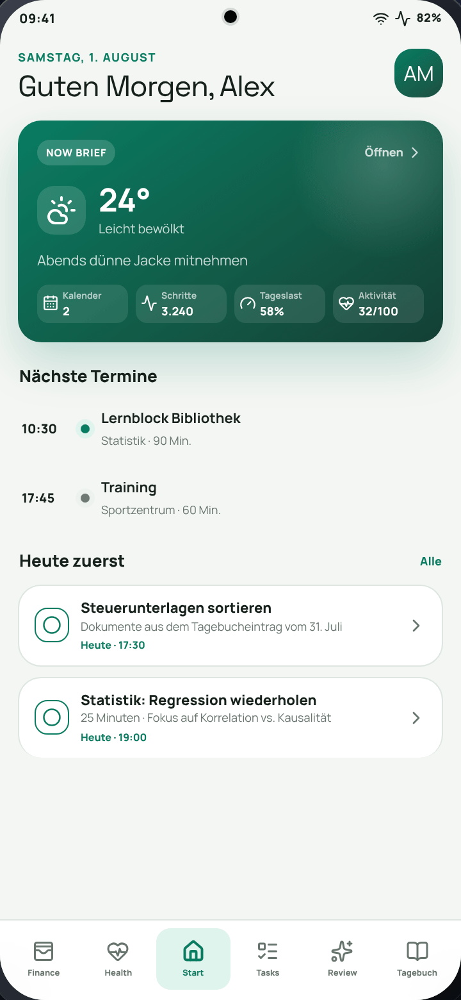
  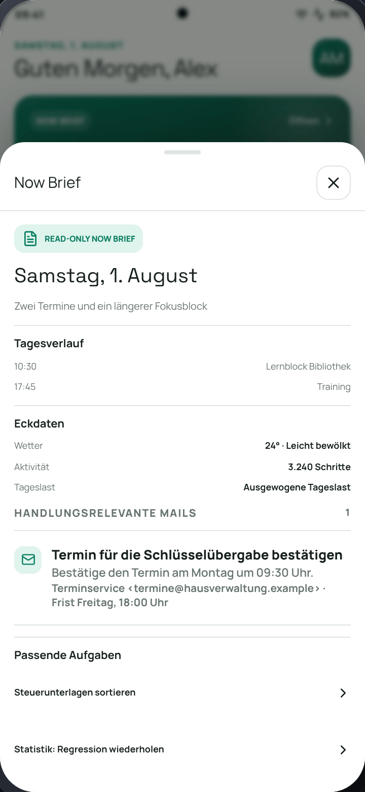
  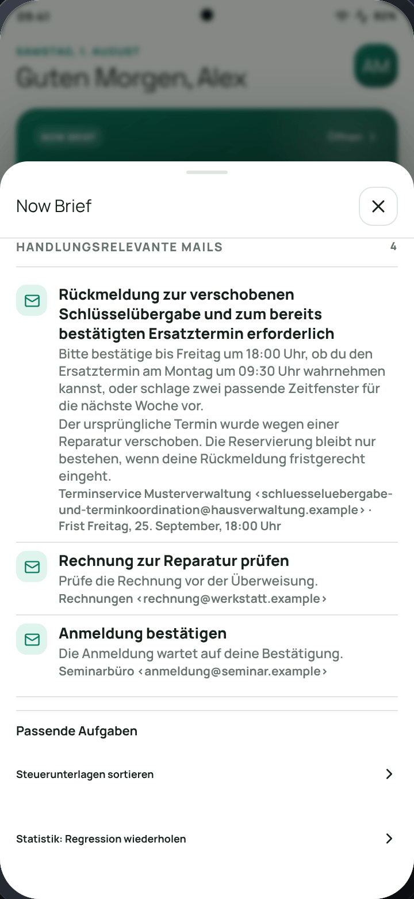

  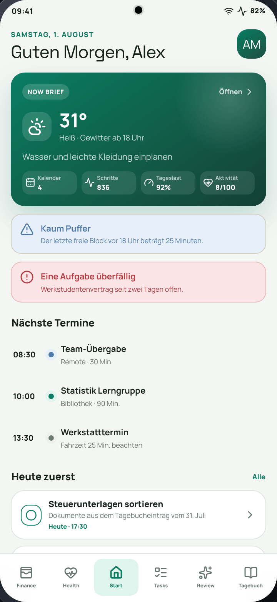
  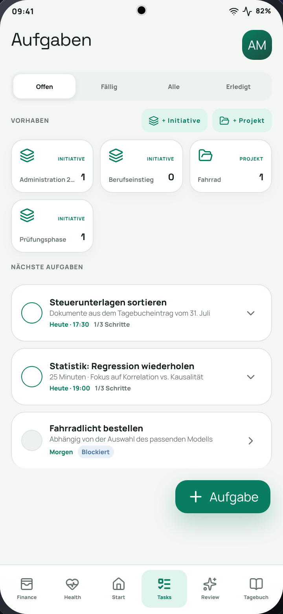
  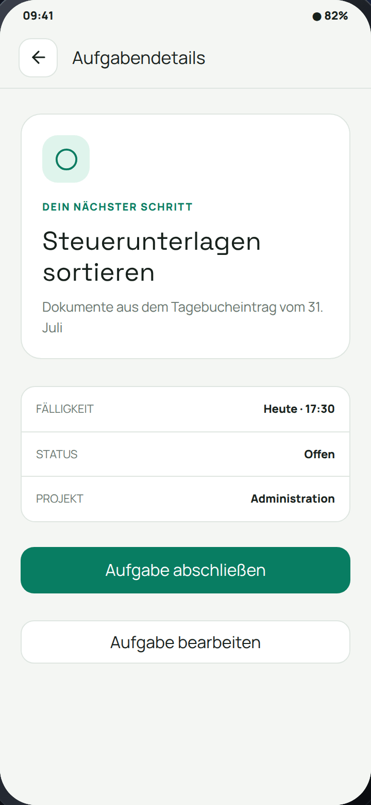

  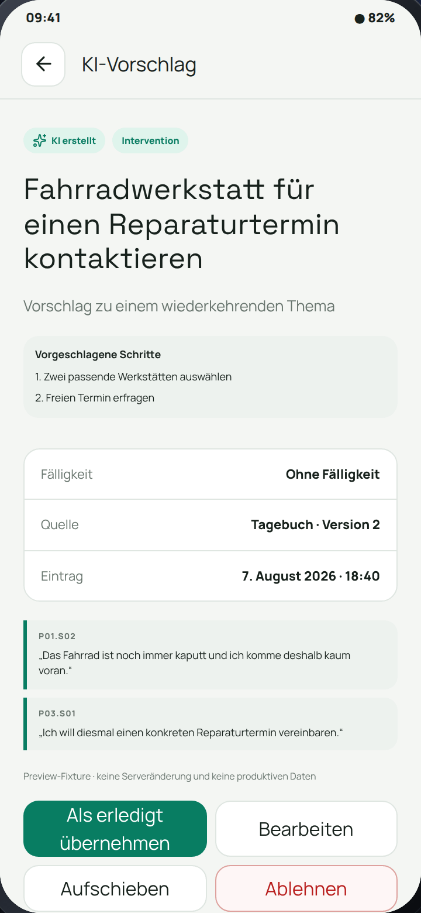
  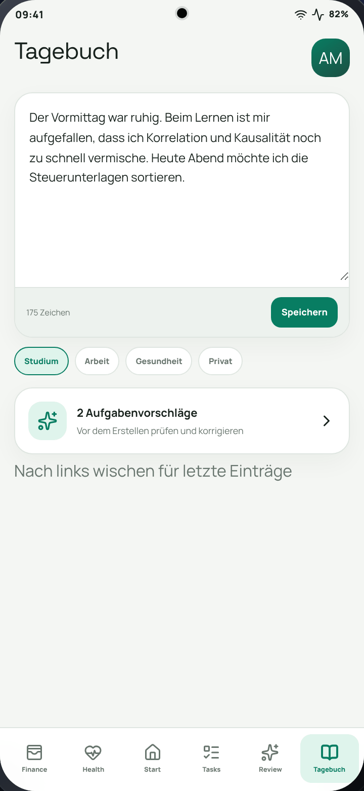
  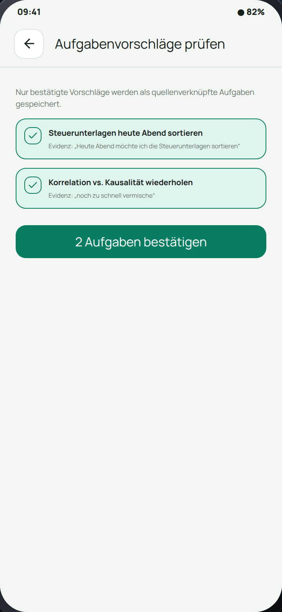

  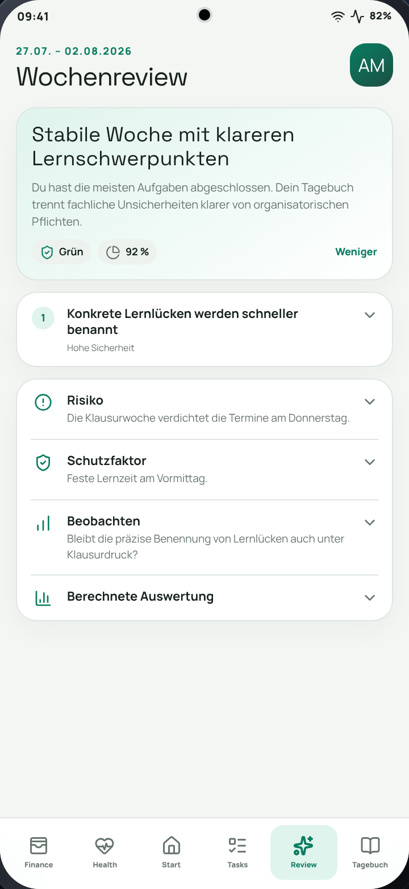
  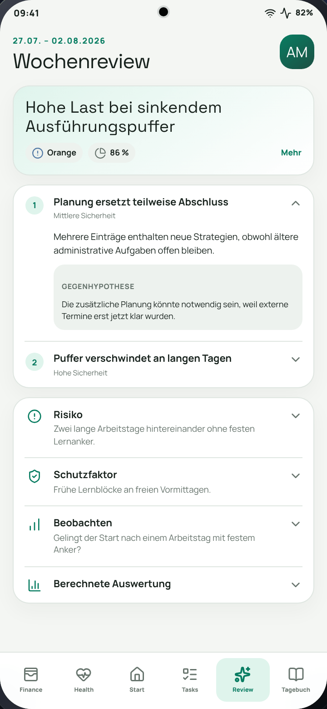
  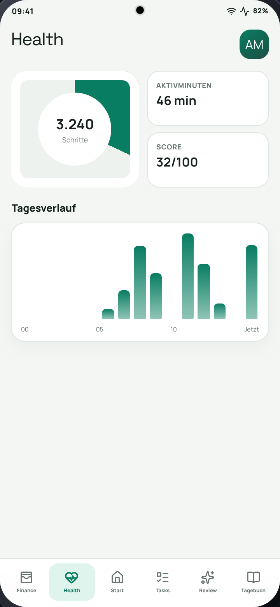

  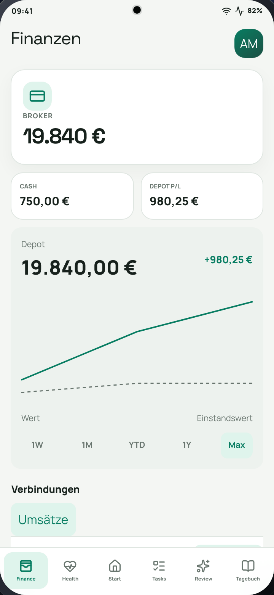
  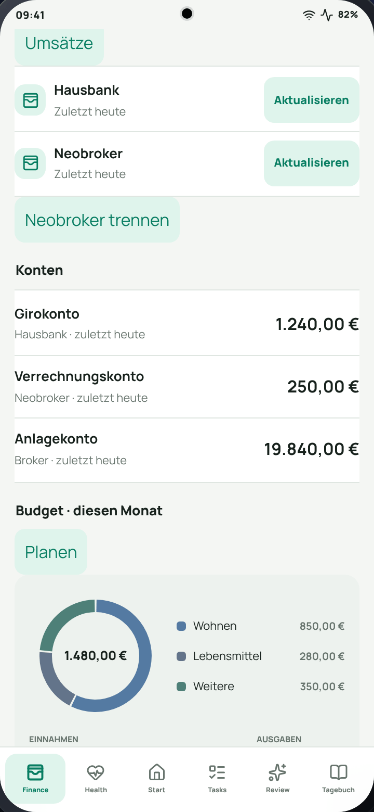
  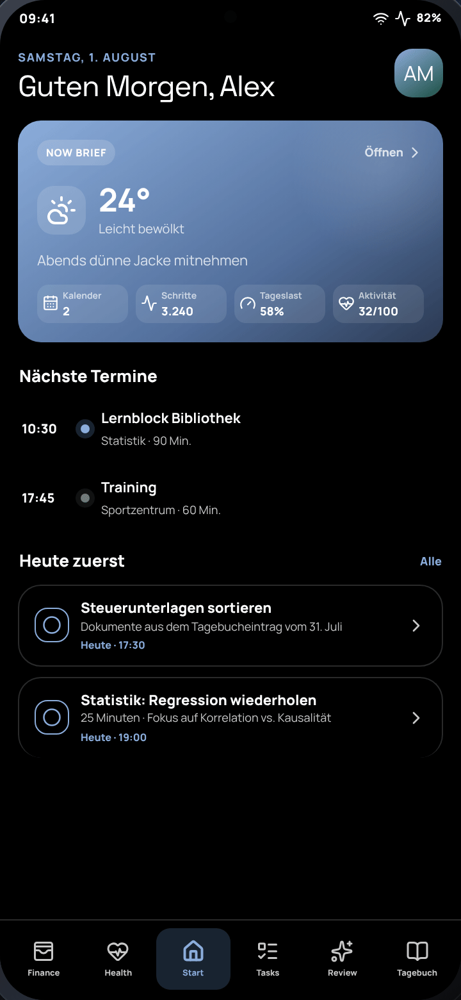

